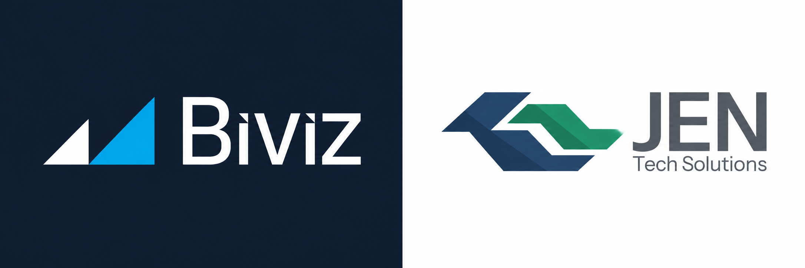

# Bivizz e Jen Tech

**Engenharia de dados, BI e automação para operações que precisam confiar nos seus números.**

Conectamos dados de ERPs, planilhas, bancos e APIs. Organizamos as regras de negócio, automatizamos as cargas e entregamos painéis que as equipes conseguem usar e manter. Também desenvolvemos sistemas sob medida quando o processo precisa de um fluxo próprio.

**[Agende um diagnóstico pelo site da Biviz](https://biviz.com.br/)**

## Como podemos ajudar

| Sua necessidade | O que entregamos |
| --- | --- |
| Dados espalhados e relatórios manuais | Pipelines ETL/ELT, integração de fontes, Data Warehouse e modelos dimensionais com regras documentadas |
| Indicadores que divergem entre áreas | Definição de KPIs com o negócio, modelos semânticos e dashboards em Power BI, Qlik Sense, Metabase ou Apache Superset |
| Ambiente Power BI lento ou difícil de governar | Diagnóstico de capacidade e desempenho, revisão de modelos e atualizações, governança de workspaces, RLS e padrões para Centros de Excelência de BI |
| Processos que ainda dependem de planilhas e e-mails | Automações em Python, SQL e Power Automate, integrações por API e sistemas web para cadastros, aprovações e documentos |

## Experiência de quem entrega

- **Denisson Fernandes** atua em engenharia de dados e administração de Power BI Premium e Microsoft Fabric. Estruturou um Centro de Excelência de BI no varejo e automatizou rotinas de administração pela API do Power BI. Tem experiência com Databricks, Python, SQL e projetos de BI para varejo, cooperativismo financeiro e indústria.
- **João Evangelista** atua em engenharia de dados, BI e governança de analytics. Tem experiência com desempenho de modelos semânticos em Power BI e Fabric, pipelines com Apache Hop e PostgreSQL e indicadores para gestão processual. Pela JEN Tech Solutions, trabalha com modelagem, integração e automação para os setores público e privado.

## Onde atuamos

Nossas frentes incluem inteligência comercial e distribuição, tecnologia para o agronegócio, gestão de compras e editais e produtos próprios. A experiência individual da dupla também abrange varejo, setor público e Judiciário.

## Vamos conversar

Se sua equipe gasta tempo conciliando números, depende de planilhas para fechar indicadores ou precisa melhorar um ambiente de BI existente, conte como o processo funciona hoje. Na primeira conversa, identificamos as fontes, quem usa os dados e qual entrega resolveria o problema mais urgente.

**[Converse com a equipe pelo site da Biviz](https://biviz.com.br/)**
